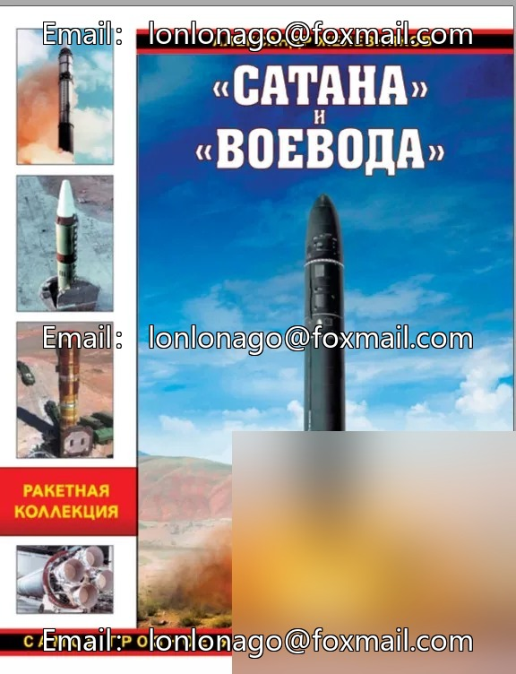
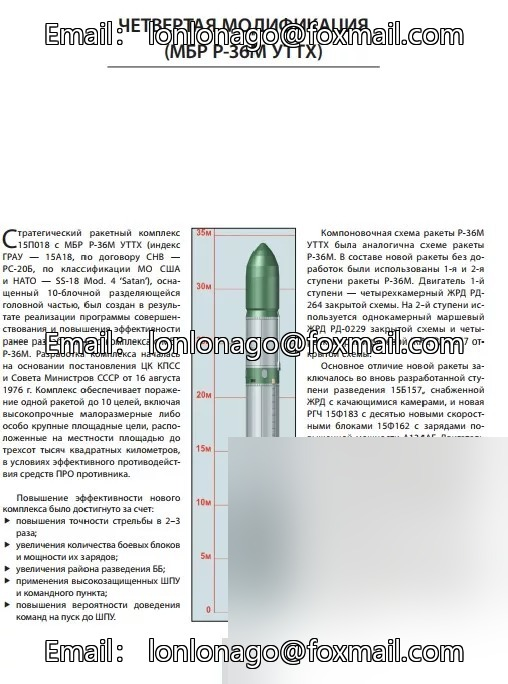
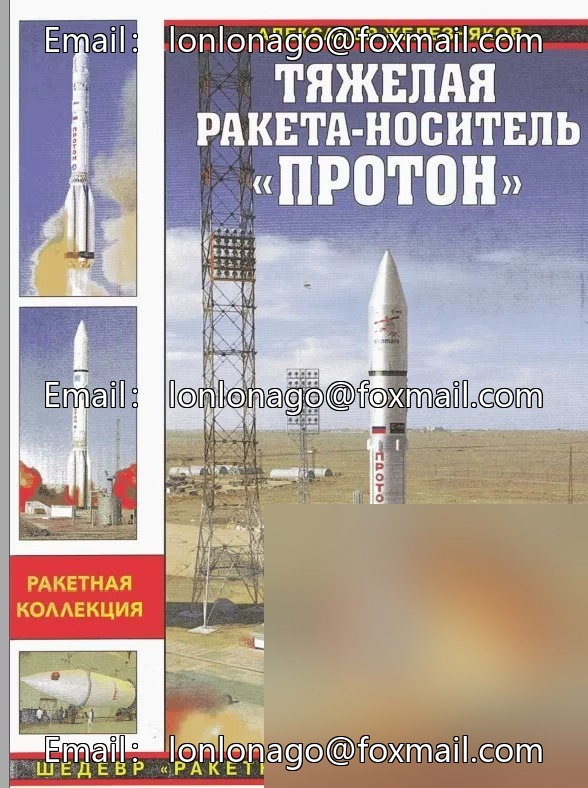
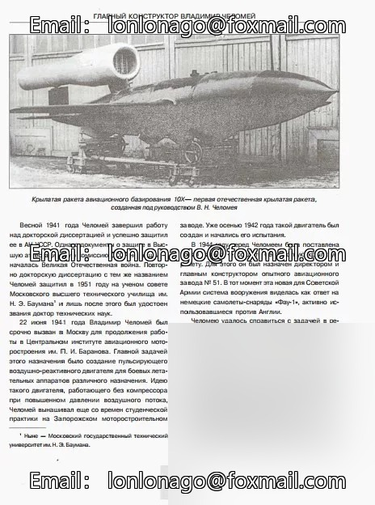
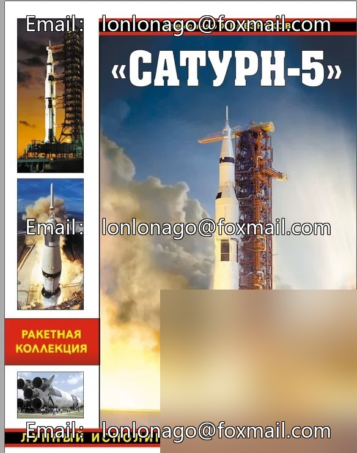
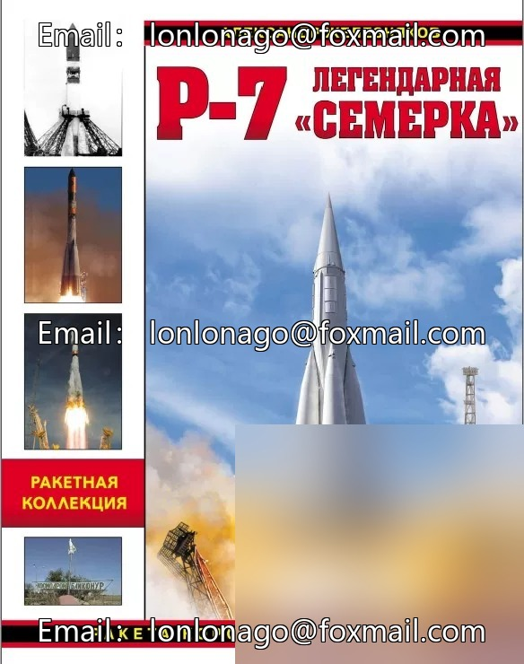
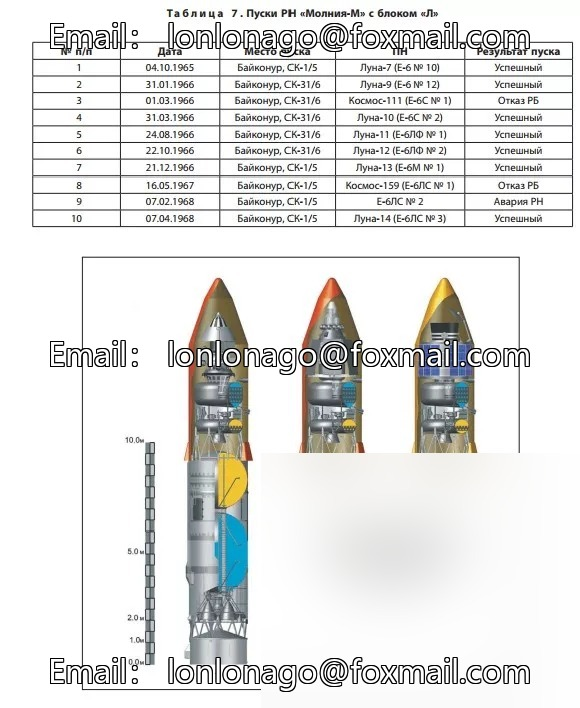

# 4 Russian about famous rocket-propelling missiles, all originating from author Alexander Tveret

## Body

Four sets of Russian on famous propulsion rockets, all come from the "Rocket Collection" series of author Alexander Jelenzykov (ALEXANDR JELENZYKOV).

"R-7" No. 7 rocket (1957)

The world's first intercontinental ballistic missile has been evolved into satellites such as "East Ming" and other satellite launch rockets.

Kolokolov designed, once launched the first man-made satellite and Gagarin entered space

Unique "bundled" design has become a classic configuration of Soviet rockets.

"Satan" and "Governor" missiles

Displaying Soviet S-18 (NATO code "Satan") and other heavy intercontinental missiles

The most deterring nuclear weapon carrier during the Cold War, with a single projectile yield of 25 million tons TNT.

"Proton" number heavy rocket (1965)

Clothom-designed world-class heavy-lift rocket

Successfully launched the Ceremonial Cannon Station space station, Venus probe, and other equipment.

Adopting a unique design with highly toxic fuel propulsion

"Soyuz 5" moon landing rocket (1967)

Team von Braun developed superheavy rockets for the Apollo program

Stays with the record of maximum loading capacity (140 tons near-lunar orbit)

Completed a total of 13 perfect launches, including 7 manned lunar landing missions.

The four Russian texts on famous rocket launch vehicles are all from the series of author Alexander Zheltzenyakov; the image includes various rocket-related identifiers and numbers.

<!-- AI_ENRICHED -->

## Images

## Payment

Here is a pay link on Stripe ( https://buy.stripe.com/3cs8yP7sY87d0vu9AB ). Please contact me lonlonago@foxmail.com after funding $89, and I will send you a complete data files , thank you!

